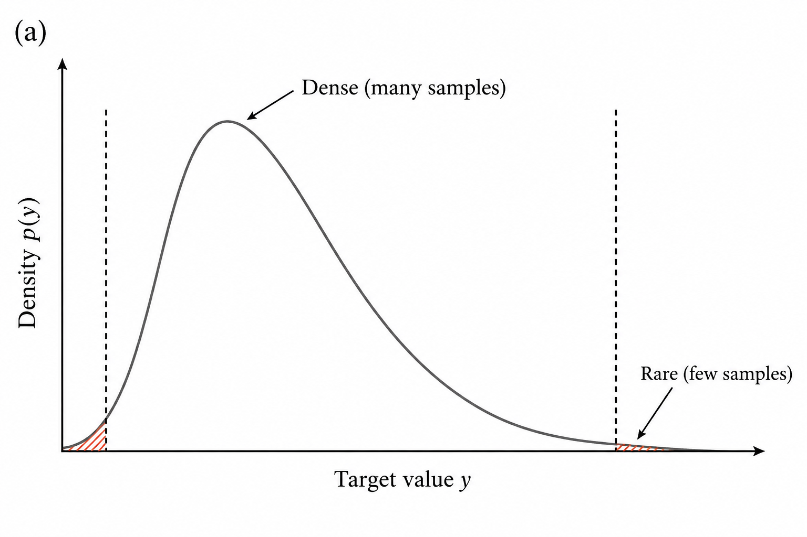
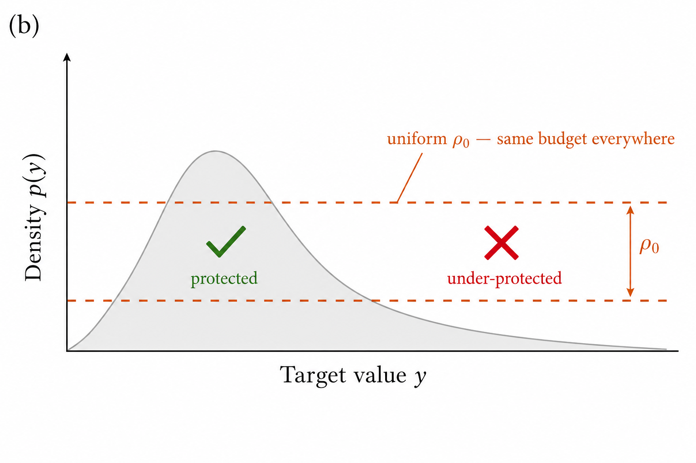
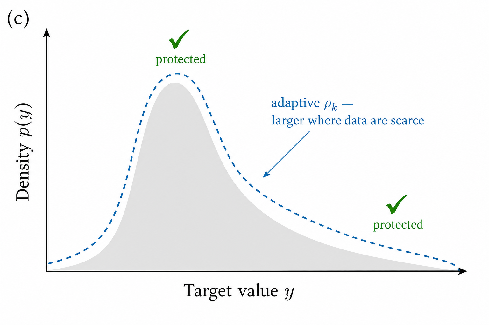
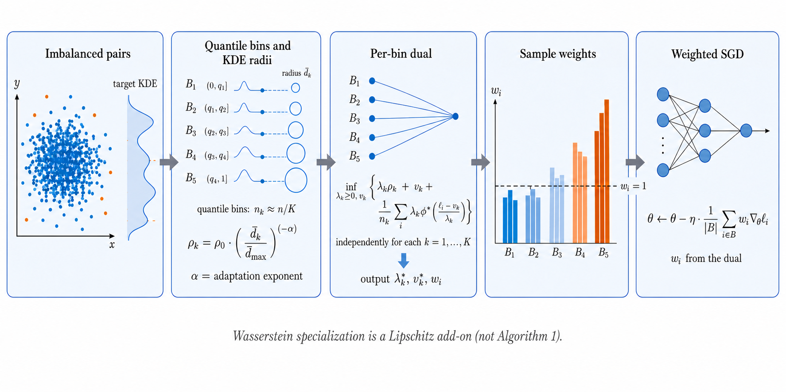
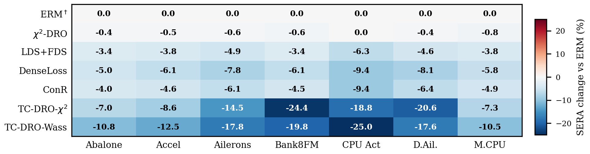

# TC-DRO

**A single ambiguity radius spends the robustness budget where the target is already dense.**

TC-DRO estimates local target density, assigns a wider radius where that density is thin, and trains with the sample weights implied by the per-bin dual. Uniform-radius DRO is kept as a control: on these tables it stays near ERM. The two target-conditional variants move the tail metric.

> **Optional supplementary material** — [`supplement/supplementary.pdf`](supplement/supplementary.pdf)
>
> Full proofs, extra tables, and diagnostic figures. The paper is self-contained; this file is extra.

<p align="center">
  <a href="supplement/supplementary.pdf"><strong>Optional supplement (PDF)</strong></a>
  &nbsp;·&nbsp;
  <a href="#quick-start"><strong>Quick start</strong></a>
  &nbsp;·&nbsp;
  <a href="#layout"><strong>Layout</strong></a>
</p>

## One radius vs. a radius per region

Most mass sits in a narrow band of the target. A pooled ball charges that band first. TC-DRO widens the ball where the estimated local density is low.

<p align="center">
  
  
  
</p>
<p align="center"><em>Left:</em> the values that matter sit in the thin part of the support. <em>Middle:</em> one radius. <em>Right:</em> a radius that follows local density.</p>

<p align="center">
  
</p>
<p align="center"><em>Quantile bins on the target, density-adaptive radii, a dual solve, then weighted SGD.</em></p>

## Tail error relative to ERM

Uniform-radius chi-squared DRO stays near the ERM row. The two TC-DRO variants move SERA.

<p align="center">
  
</p>
<p align="center"><em>SERA change versus ERM</em> (negative is an improvement).</p>

## Quick start

Python 3.10+ recommended.

```bash
pip install -r requirements.txt
python scripts/smoke_test.py
```

The smoke test checks loss truncation and runs a tiny loop for each listed method.

## Reproduce the tables

```bash
python scripts/run_experiments.py --config configs/default.yaml --output-dir ./outputs
```

- `--output-dir` is a fresh directory for each sweep.
- `--datasets`, `--methods`, and `--seeds` narrow the grid.

Datasets are fetched from OpenML by name on first download.

```bash
python scripts/validate_tables.py --show-marks
```

`results/table_capsule.json` stores every published cell. The check recomputes each average from the seven dataset cells. Exit code 0 means the stored tables are internally consistent.

## What the trainer does

- **Chi-squared TC-DRO.** Per-bin dual; sample weights are the adversarial reweighting implied by that ball.
- **Wasserstein TC-DRO.** A Lipschitz-penalty surrogate, not an optimal-transport plan and not the *f*-divergence dual.
- **Truncated training loss.** The per-sample squared residual is bounded at *M* = 9 (standardized targets) before the dual and before the weighted backward pass. Test MSE / MAE / SERA / coverage use the raw predictions.
- **Uniform-radius Wasserstein DRO.** Returns uniform weights by construction. That collapse is a reported finding, not a missing solver.

Base learner: MLP. Metrics: MSE, MAE, SERA, tail MSE/MAE, tail coverage.

## Layout

```
configs/           training / DRO / baseline grids
results/           published table cells (provenance capsule only)
src/data/          OpenML-backed loaders
src/dro/           ambiguity sets and TC-DRO trainer
src/evaluation/    metrics
src/models/        MLP and wrappers
scripts/           smoke test, full grid, table check
docs/figures/      manuscript figures used in this README
supplement/        optional supplementary PDF
```

## Citation

```bibtex
@inproceedings{kang2026taming,
  title     = {Taming the Tails: Why Distributionally Robust Optimization Needs New Theory for Imbalanced Regression},
  author    = {Kang, Nathaniel},
  booktitle = {Advances in Neural Information Processing Systems},
  volume    = {39},
  year      = {2026}
}
```

## License

Research and reproducibility use.
